 

<h2 align="center">About Me</h2>

I'm a software developer working across <b>AI/ML</b> and <b>full-stack engineering</b>. 
I build AI agents and LLM apps, and <b>full-stack apps with Flutter and Spring Boot</b>, 
plus web products with <b>Next.js, Express and TypeScript</b>.

  
  
  

<h2 align="center">Tech Stack</h2>

<h4>Languages</h4>

<h4>Frameworks</h4>

<h4>AI &amp; LLM</h4>

<h4>Databases &amp; Tools</h4>

<h2 align="center">Contribution Calendar</h2>

<h2 align="center">Connect With Me</h2>

  
  
  

<i>Open to collaborating on meaningful projects.</i>

